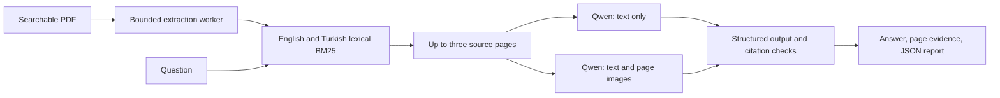

# Architecture

EvidenceDoc separates document processing, retrieval, inference, and citation validation. The application intentionally uses the same model and retrieved context for its text-only and hybrid modes.

## Processing boundaries

`documents.py` checks upload size and delegates text extraction to `pdf_worker.py`. The worker sets Linux memory/CPU limits before importing PDF libraries. A parent timeout bounds its lifetime. Unsupported page geometry is rejected before retrieval; the validated document bytes are kept in memory for page previews.

`retrieval.py` applies case handling, English and Turkish stemming, and BM25 page ranking. Stemmer instances are local to a tokenization call so concurrent searches cannot corrupt shared mutable state. English stopwords are removed in addition to Turkish stopwords. This remains lexical retrieval; no semantic or translation model is involved.

`inference.py` lazily loads a pinned official Qwen checkpoint using safetensors and without remote model code. A lock serializes model load and generation. The model receives numbered source blocks; the application resolves those IDs to physical PDF pages. Outputs are requested in English, while exact quotes retain their source language.

`service.py` validates output types and size, resolves source IDs, and checks normalized quote presence in the corresponding retrieved text. Unsupported answers are not silently replaced with generated-looking extractive output. Absence of a source, model abstention, invalid JSON, and rejected citations have separate statuses.

`reports.py` writes atomic JSON exports and removes expired managed reports and Gradio cache copies. The stable application-specific temporary directory enables cleanup after process restarts. The 64-file cap applies to original report files; cached copies use age-based expiration.

## Inference identity

- Model: `Qwen/Qwen3-VL-2B-Instruct`
- Revision: `89644892e4d85e24eaac8bacfd4f463576704203`
- Generation: greedy, at most 256 new tokens
- Images: at most three, each reduced to fit 512 × 512 pixels
- Context: at most 6,000 extracted characters per source page

The citation gate checks occurrence, not semantic entailment. This distinction is retained in the interface and report schema.
